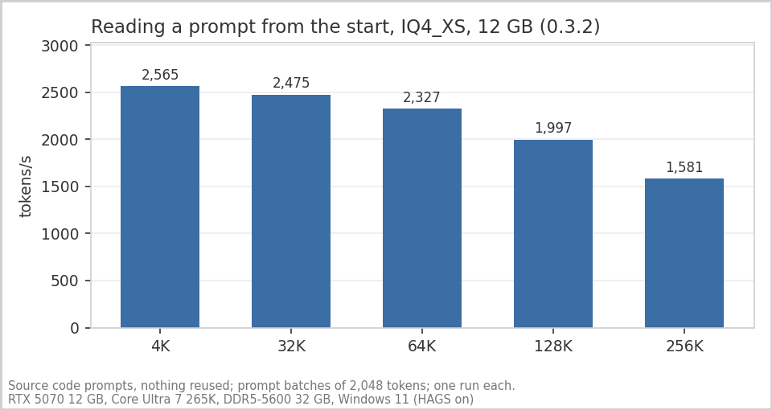
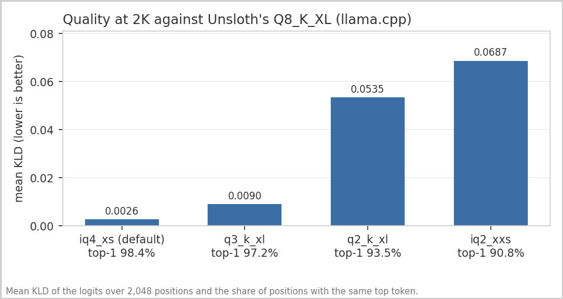

# inkling-5070

[日本語](README.md)

> **Unofficial.** An independent fork built on [Strata](https://github.com/Niko1221/Strata) and
> [PolyStrata](https://github.com/simplexai-labs/PolyStrata); it is not part of either project and is not supported
> by their authors.

> **Status (0.3.2)**
> - The default IQ4_XS against llama.cpp's logits (IQ4_XS, fp16 KV): mean KLD 0.0049, top-1 agreement 97.4% at a 2K
>   context; mean KLD 0.0075, top-1 96.9% at a 128K context.
> - Against Unsloth's Q8_K_XL (llama.cpp) at 2K: mean KLD 0.0026, top-1 98.4%.
> - The smaller models (Q3_K_XL / Q2_K_XL / IQ2_XXS) were checked at 2K only.
> - Pictures: a photo, a screenshot and a chart were described correctly (no benchmark).
> - Tested on one PC only (RTX 5070 / Windows 11). The 8 GB and 6 GB figures were measured on that RTX 5070 with its
>   VRAM limited; no real 8 GB or 6 GB card has been tried.
> - setup's model download has not been tried end to end yet (the SHA-256 check has been).

Inkling 2 Mini (Thinking Machines, 26.4B total / 3.4B active, looped MoE) on one NVIDIA GPU plus system RAM, with
the experts that do not fit in VRAM computed on the CPU.

- **GPUs:** tuned and tested on an RTX 5070. It is built to run on the RTX 20 to 50 series, but no other GPU has been
  tried.
- **How it differs from other 12 GB projects:** those quantize to low bits so that the whole model fits in VRAM; this
  one keeps the 4-bit IQ4_XS weights and computes the experts that do not fit on the CPU, up to a 128K context
  (256K if asked for).
- Model: Unsloth's `Inkling-2-Mini-UD-IQ4_XS.gguf` (15.7 GB) by default; smaller, faster ones can be chosen (below).
  An online VRAM expert cache keeps the most used experts on the GPU.
- Exact by default: every routed expert is computed; context-lookup drafting is verified. Expert skipping is an
  opt-in approximation (below).
- Engine: PolyStrata's `strata-poly` (on Strata) cut down to Inkling 2 and tuned on Windows. Server: PolyStrata's.
  See [UPSTREAM.md](UPSTREAM.md) and [NOTICE](NOTICE).

Much of the code and documentation was written with the help of AI.

Measured on: RTX 5070 12 GB, Core Ultra 7 265K, DDR5-5600 32 GB, Windows 11, driver 610.60.

**Keep Windows' Hardware-accelerated GPU scheduling (HAGS) on.** With it off, the GPU took 5-6 times as long to start what the host sent it, and writing was 10-20% slower (62-64 -> 54 tok/s at 8K).

## What to use, by VRAM

Writing speed (temperature 1.0, tok/s). The 12 GB IQ4_XS row is 0.3.2, measured after one warm-up answer on the same prompt (the first answer after a start is about 10% slower, while the expert cache settles). The other rows are 0.3.1's (after an 8K prompt, or after reading the last 8K of a saved long context).

| VRAM | Choice | 8K | 64K | 128K | 256K |
|---|---|---|---|---|---|
| 12 GB | IQ4_XS (default), 128K | 70.7-71.5 | 54.7-55.5 | 44.3 | 36.6 (`--context 256k`) |
| 8 GB | IQ4_XS (quality) | 51.4 | 34.3 | 25.3 | does not fit |
| 8 GB | Q3_K_XL (speed) | 57.6 | 38.8 | 26.1 | does not fit |
| 6 GB | IQ4_XS or Q3_K_XL, up to 64K | 35.0 / 39.0 | 19.4 / 22.2 | does not fit | does not fit |

- The figures vary by about ±2% between measuring sessions.
- 12 GB: prose and code contexts at 8K and 64K, code at 128K and 256K. 256K was measured with the bench settings (2,048-token prompt batches, 400 MiB of VRAM left free).
- **8 GB / 6 GB:** measured on this RTX 5070 with its VRAM limited by `--vram-reserve-mib` (not on real cards), with
  2,048-token prompt batches. setup picks 1,024 / 512 for those cards, which leaves more VRAM for experts, so writing
  should be faster than this (not measured).
- **Context:** setup picks 32K on 8 GB and 16K on 6 GB; for the lengths above use e.g. `setup.bat --context 128k`.
- **Long contexts narrow the gaps:** the KV cache takes the experts' VRAM and most of them run on the CPU.




The charts are drawn from `docs/charts/measurements.json` by `python docs/charts/make_charts.py`.

### Quality and speed of each model

Quality: 2K context against Unsloth's Q8_K_XL logits (llama.cpp); a lower KLD is closer to Q8.

| Model (`--model`) | File | Mean KLD | Top-1 | 12 GB writing (8K / 128K) |
|---|---|---|---|---|
| `iq4_xs` (default) | 15.7 GB | 0.0026 | 98.4% | 70.7 / 44.3 (0.3.2) |
| `q3_k_xl` | 13.6 GB | 0.0090 | 97.2% | 69.0 / 45.1 |
| `q2_k_xl` | 9.1 GB | 0.0535 | 93.5% | 74.0 / 45.4 |
| `iq2_xxs` | 8.5 GB | 0.0687 | 90.8% | 79.9 / 51.6 |

- Speeds vary by about ±2% between measuring sessions. All but IQ4_XS are 0.3.1's.
- Q2_K_XL and IQ2_XXS are fast, but their measured quality drop is large (KLD about 20-26x IQ4_XS's); setup says so
  when one is chosen.
- The smaller models come from the same Unsloth repository and revision, SHA-256 checked.



### 256K (12 GB)

`setup.bat --context 256k` (setup then uses 1,024-token prompt batches and leaves 200 MiB free). After reading the
last 8K of a ~245K-token context (0.3.1):

| Model | Experts in VRAM | Writing (temperature 1.0) | Reading the last 8K |
|---|---|---|---|
| IQ4_XS | 898 / 3072 | 33.6 tok/s | 848 tok/s |
| Q2_K_XL | 1776 / 3072 | 38.1 tok/s | 942 tok/s |
| IQ2_XXS | 1903 / 3072 | 36.9 tok/s | 956 tok/s |

At 256K the three are close, so IQ4_XS (the best quality) is the recommendation. Reading 256K from the start: 1,355
tok/s (IQ2_XXS).

## Speed on that PC (IQ4_XS, 12 GB)

One request; 200 tokens after the first 16. This engine's temperature-1.0 writing and its prompt reads are 0.3.2, after one warm-up answer on the same prompt; the greedy rows and NInfer are 0.3.1's. 128K writing: after a 128K code context.

| | This engine | NInfer 2026-11-22.2 (Windows) |
|---|---|---|
| 8K, temperature 1.0 | 70.7 tok/s | 49.7 tok/s |
| 8K, greedy | 68.9 tok/s | 51.5 tok/s |
| 8K, greedy + lookup drafting | 69.7 tok/s | |
| 8K prompt | 2,247 tok/s (0.3.1; 0.3.2: 2,565 at 4K, 2,475 at 32K) | 2,171 tok/s |
| 128K, temperature 1.0 | 44.3 tok/s | 26.2 tok/s |
| 128K, greedy | 42.9 tok/s | 26.3 tok/s |
| 128K prompt (whole context) | 1,997 tok/s | 663 tok/s |
| CPU while writing | 7-8 cores | ~10 cores |

- This engine's figures vary by about ±2% between measuring sessions.
- NInfer: `--expert-residency host --host-cache-mib 1024 --spec none`, MXFP8 KV, same tokens. Its top_k is capped
  at 20 (this engine samples from the whole vocabulary). Its docs report 83.5 tok/s on an RTX 5070 under Linux;
  on Windows it disables CUDA graphs for this model. [docs/ninfer_comparison.md](docs/ninfer_comparison.md)
- Against llama.cpp's logits (IQ4_XS, fp16 KV; this engine's KV is q8_0):
  - 2K (2,048 tokens): mean KLD 0.0049, top-1 97.4%
  - 128K (the last 1,023 positions of a 124,928-token context): mean KLD 0.0075, top-1 96.9%
  - Against Q8_K_XL at 2K: mean KLD 0.0026, top-1 98.4%
- A conversation's next turn reuses the start it shares with the last one: turn 2 of a 32K conversation read in
  0.23 s (15.6 s read again from the start).
  - After an agent compacts the conversation, the system prompt and the tool definitions are not read again either
    (a checkpoint that is never dropped sits where the first turn ends). In a 60K conversation the turn after a
    compaction read 62 tokens instead of 6,977 (0.4 s instead of 4.2 s). `STRATA_SYS_CHECKPOINT=0` turns this off.
  - Send the tool definitions from the first turn on: adding them later changes the start, which is then read again.
- More: [docs/measurements.md](docs/measurements.md)

## For long contexts: a 4-bit V cache (a little lower quality)

`--kv k8v4` keeps the attention's values in 4 bits (each block of 32 rotated by a Walsh-Hadamard transform before it is quantized) and its keys in 8 bits. The KV cache is about a fifth smaller than the default (`q8_0`), and the VRAM goes to experts. Off by default; to use it, set `--kv` to `k8v4` in `args` in `config\inkling.json`.

| | default (q8_0) | k8v4 |
|---|---|---|
| KV a token | 17,408 bytes | 13,312 bytes |
| Experts in VRAM at 256K | 673 | 927 |
| Writing at 256K (temperature 1.0) | 30.4 tok/s | 35.8 tok/s |
| 2K KLD vs Q8 | 0.0026 | 0.0049 |
| 128K KLD vs llama.cpp / top-1 | 0.0075 / 96.9% | 0.0124 / 96.1% |

- The 256K speeds were measured in 0.3.1's time (the first answer after a start); they compare runs of one session.
- At 128K its quality drop is a little past this project's bar (1.5x the default's KLD). It is a choice for speed at 256K.

## Faster, approximate: expert skipping

`--skip-weight W` leaves out a routed expert outside VRAM whose router weight is under W of its token's total (the
experts in VRAM are always computed). The output changes; off by default. Add it to `args` in `config\inkling.json`.

| `--skip-weight` | 128K writing (IQ4_XS, 12 GB) | 2K KLD vs Q8 |
|---|---|---|
| none (default) | ~43-45 tok/s (43.0 in this table's session) | 0.0026 |
| 0.06 | 45.1 tok/s (+5%) | 0.0031 |
| 0.08 | 46.7 tok/s (+9%) | 0.0038 (0.0047 with a 128K-sized cache) |
| 0.12 | 50.5 tok/s (+17%) | 0.0071 (0.0106) |

The percentages compare runs of one session; the figures vary by about ±2% between sessions. Little gain where most
experts are in VRAM (8K). Quality at 128K was not measured.

### Experimental: loop count (`--loops N`)

`--loops N` (1 to 3, default 3) runs the loop layers (6 to 17) fewer times. It is faster (8K writing: about 1.2x with
2, about 1.8x with 1), but the answers break down, so it is not for everyday use (2K KLD: 3 loops 0.0026 / 2 loops 0.70
/ 1 loop 0.87). A session saved with one loop count does not load with another. It is an experiment, for a model
trained with a different loop count.

## Requirements

- Windows 10/11 x64
- NVIDIA GPU, compute capability 7.5+ (RTX 20 to 50), 8 GB VRAM or more (6 GB measured only with the VRAM limited).
  Built for 7.5, 8.6, 8.9, 12.0 + PTX.
- Driver 580+ (CUDA 13)
- RAM 16 GB+, 32 GB recommended (up to 9 GB of experts in RAM; with less, experts are read from the SSD and
  writing slows down)
  Up to 2 GB of host memory is pinned for reading long prompts (Task Manager shows it as shared GPU memory).
- ~20 GB free disk for IQ4_XS and the image encoder (10-15 GB for the smaller models)
- Python 3.10+ (setup creates a venv and installs the server's packages into it)

## Use

1. Unpack the release zip (or build, below).
2. `setup.bat`: checks the GPU/driver/RAM/disk, downloads the model (resumable) and the image encoder's weights (0.35 GB; `--vision off`: none) and checks their SHA-256, creates
   `.venv` with the server's Python packages, and writes the settings to `config\inkling.json`. At the end it prints
   estimates for the choice (usable VRAM, KV cache size, experts in VRAM) and tables of other context lengths and
   models with the speeds measured above.
3. `run.bat`: an OpenAI-compatible server (Chat Completions, Responses, Anthropic Messages, a chat page) on
   `http://127.0.0.1:8080`, local only. After the start and after each request it prints the experts in VRAM, their
   share and the hit rate (`--quiet` leaves that out).

```bash
curl http://127.0.0.1:8080/v1/chat/completions -H "Content-Type: application/json" \
  -d '{"model": "inkling-2-mini", "messages": [{"role": "user", "content": "Hello"}], "reasoning_effort": "medium"}'
```

`"reasoning_effort": "none"` (or `"chat_template_kwargs": {"enable_thinking": false}`) answers without thinking.
A request that sends no thinking level thinks at `medium` (`setup.bat --thinking`). For an agent that writes files,
`medium` or lower is recommended: at `high` the model often drafts the files in its thinking and reaches `max_tokens`.

| Option | |
|---|---|
| `setup.bat --model NAME` | `iq4_xs` (default) / `q3_k_xl` / `q2_k_xl` / `iq2_xxs` |
| `setup.bat --vision off` | no pictures (default `cpu`: the image encoder on the CPU) |
| `setup.bat --vision-max-tokens N` | the most tokens a picture takes (default 1,024; larger ones are scaled down) |
| `setup.bat --thinking LEVEL` | the thinking level of requests that send none: `low` / `medium` (default) / `high` |
| `setup.bat --context N` | context length (`64k` / `128k` / `256k` too) |
| `setup.bat --port N` | server port |
| `setup.bat --limit-ram-gb 16 --limit-vram-gb 8` | settings for a smaller budget |
| `setup.bat --configure-only` | choose the settings again, no download |
| `run.bat --api-key KEY` | require a key |
| `run.bat --quiet` | no lines about the experts and speed |

Settings setup chooses by usable VRAM: 128K context / 2,048-token prompt batches from 12 GB (256K with
`--context 256k`: 1,024), 64K / 1,024 from 10 GB, 32K / 1,024 from 8 GB, 16K / 512 below; experts in RAM = RAM - 14 GB
(max 9 GB); up to 12 CPU threads.

## Known limits

- Output varies slightly between runs, greedy included: which experts run on the GPU or the CPU follows the cache,
  and the two sum in different orders.
- 7-8 CPU cores busy while writing (the expert threads spin between layers; idle between requests).
- ~12 GB of RAM for the engine with the default 9 GB expert budget, plus the OS file cache.
- Tested on Windows, on one PC.
- A little further from the reference at 128K: against llama.cpp, mean KLD rises from 0.0049 at 2K to 0.0075 (top-1 97.4% to
  96.9%). The reference uses fp16 KV; this engine uses q8_0.
- With tools and thinking off, the model may still think briefly before its call.
- Pictures are on by default (`setup.bat --vision off` turns them off). The image encoder runs on the CPU and takes
  no VRAM: about 0.5 GB of RAM, started by the first picture and stopped after two idle minutes. A 640 x 400 picture
  takes about 0.7 s and 160 tokens, 1920 x 1200 about 5.8 s and 1,000 tokens (Core Ultra 7 265K, at most 1,024
  tokens; `--vision-max-tokens 300` brings large ones to about 1.3 s and 273 tokens). With pictures on, the experts in
  VRAM and the writing speed stay the same (checked at 8K and 128K). OpenAI `image_url` parts (base64 or URL) and
  Anthropic image blocks.

## Build

Visual Studio 2022+ (C++ desktop), CUDA Toolkit 13.x, Python 3.10+.

```bat
tools\build.bat            :: compute capability 7.5 / 8.6 / 8.9 / 12.0 (slow)
tools\build.bat --native   :: this PC only
```

Output: `build\bin` (setup finds it). The image encoder (`strata-vision.exe`, CPU): `tools\build_vision.bat` with
`LLAMA_DIR` set to a llama.cpp checkout (690b87d88 or later), into `build-vision\bin`. `python tools\package.py --version X` writes the release zip to `dist\`.

## Measuring

`bench\` (notes in Japanese, `bench\README.md`): `bench.py` (speed; `--model` another model, `--text code256` 256K),
`quality.py` (2K logits vs llama.cpp), `quality_2k.py` (settings against the saved 2K references, IQ4_XS and
Q8_K_XL), `quality_all.py` (2K and 128K, unattended), `ninfer_bench.py` (NInfer on the same tokens).

## License

MIT ([LICENSE](LICENSE)); components in [NOTICE](NOTICE). The model (Apache-2.0) is downloaded separately.
