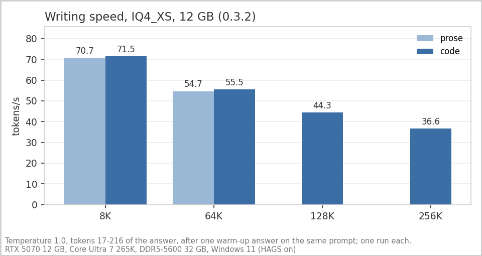

# inkling-5070

[English](README.en.md)

> **非公式です。** [Strata](https://github.com/Niko1221/Strata) と [PolyStrata](https://github.com/simplexai-labs/PolyStrata)
> をもとにした独立のフォークで、どちらのプロジェクトの一部でもなく、作者によるサポートもありません。

> **確認の状況（0.3.2）**
> - 既定の IQ4_XS の品質は llama.cpp（IQ4_XS、KV fp16）のロジットと照合しました。2K の文脈で KLD 平均 0.0049、
>   上位 1 位の一致 97.4%、128K の文脈で KLD 平均 0.0075、上位 1 位の一致 96.9% です。
> - Unsloth の Q8_K_XL（llama.cpp）を基準にすると、2K で KLD 平均 0.0026、上位 1 位の一致 98.4% です。
> - 小さいモデル（Q3_K_XL / Q2_K_XL / IQ2_XXS）の品質は 2K だけで確かめました。
> - 画像入力は、写真・スクリーンショット・図の 3 枚で内容を正しく説明できることを確かめました（ベンチマークはしていません）。
> - 動作を確かめたのは 1 台の PC（RTX 5070 / Windows 11）だけです。8 GB と 6 GB の値は、この RTX 5070 の VRAM を
>   制限して測ったもので、実際の 8 GB / 6 GB のカードでは確かめていません。
> - setup のモデルのダウンロードは、最初から最後までの通しではまだ試していません（SHA-256 の確認は動作を確かめ済み）。

Thinking Machines の Inkling 2 Mini（全体 264 億、1 トークンで使うのは 34 億パラメーター、ループ構造の MoE）を、
NVIDIA の GPU 1 枚と PC のメモリで動かすエンジンです。

- **対象の GPU:** RTX 5070 で調整し、動作を確かめました。作りとしては RTX 20〜50 シリーズで動きますが、
  ほかの GPU では確かめていません。
- **ほかの 12 GB 向けプロジェクトとの違い:** よくある方式は、低ビットに量子化してモデル全体を VRAM に載せます。
  このエンジンは 4 ビット（IQ4_XS）のまま、VRAM に入らないエキスパートを CPU で計算して、128K（256K まで設定可）の
  文脈を使います。
- **モデル:** 既定は Unsloth の `Inkling-2-Mini-UD-IQ4_XS.gguf`（15.7 GB）。速さ優先の小さいモデルも選べます（下の表）。
  - よく使うエキスパートは、VRAM のキャッシュに置いて生成しながら入れ替えます。
- **厳密さ:** 既定では、選ばれたエキスパートを全部計算します。会話内の繰り返しによる推測は、検証してから採用します。
  エキスパートを飛ばす近似は opt-in です（下の「速さ優先のオプション」）。
- **由来:**
  - エンジン: PolyStrata の `strata-poly`（Strata が土台）を Inkling 2 用に絞り、Windows で調整したもの
  - サーバー: PolyStrata のもの
  - 詳しくは [UPSTREAM.md](UPSTREAM.md) と [NOTICE](NOTICE)

コードと文書の多くは AI を使って作成しました。

計測した PC: RTX 5070 12 GB、Core Ultra 7 265K、DDR5-5600 32 GB、Windows 11、ドライバー 610.60。

**Windows の「ハードウェア アクセラレータによる GPU スケジューリング」（HAGS）はオンを推奨します。** オフにすると、GPU が命令を受けてから動き出すまでが 5〜6 倍に延び、生成が 1〜2 割遅くなりました（8K で 62〜64 → 54 tok/s）。

## VRAM ごとのおすすめ

生成の速さ（温度 1.0、tok/s）。12 GB の IQ4_XS は 0.3.2 で、同じプロンプトで 1 回答えさせた後に測った値です（起動直後の 1 回目は、エキスパートのキャッシュが落ち着く前なので 1 割ほど遅くなります）。ほかの行は 0.3.1 の計測（8K は 8K のプロンプトの後、長い文脈は保存した文脈の後ろに 8K を読んだ後）です。

| VRAM | おすすめ | 8K | 64K | 128K | 256K |
|---|---|---|---|---|---|
| 12 GB | IQ4_XS（既定）、128K | 70.7〜71.5 | 54.7〜55.5 | 44.3 | 36.6（`--context 256k`） |
| 8 GB | IQ4_XS（品質重視） | 51.4 | 34.3 | 25.3 | 入らない |
| 8 GB | Q3_K_XL（速さ重視） | 57.6 | 38.8 | 26.1 | 入らない |
| 6 GB | IQ4_XS または Q3_K_XL、64K まで | 35.0 / 39.0 | 19.4 / 22.2 | 入らない | 入らない |

- 値には計測時期による ±2% 程度のばらつきがあります。
- 12 GB の 8K・64K は文章とコード、128K・256K はコードの文脈です。256K は計測用の設定（読み込みの単位 2,048、VRAM の残り 400 MiB）で測りました。
- **8 GB / 6 GB の値:** この RTX 5070 の VRAM を `--vram-reserve-mib` で制限して測ったものです（実際のカードでは未確認）。
  読み込みの単位は 2,048 トークンで測りました。setup が 8 GB / 6 GB で選ぶ 1,024 / 512 では VRAM に入るエキスパートが
  増えるので、生成はこの表より速くなる見込みです（未計測）。
- **文脈:** setup は 8 GB で 32K、6 GB で 16K を選びます。表の長さを使うときは `setup.bat --context 128k` のように指定します。
- **長い文脈では差が小さくなります。** KV がエキスパートの場所を取り、ほとんどを CPU で計算するためです。




図は `docs/charts/measurements.json` の計測値から `python docs/charts/make_charts.py` で作っています。

### モデルごとの品質と速さ

品質は 2K の文脈で、Unsloth の Q8_K_XL（llama.cpp）のロジットとの照合です（KLD は小さいほど Q8 に近い）。

| モデル（`--model`） | ファイル | KLD 平均 | 上位 1 位の一致 | 12 GB の生成（8K / 128K） |
|---|---|---|---|---|
| `iq4_xs`（既定） | 15.7 GB | 0.0026 | 98.4% | 70.7 / 44.3（0.3.2） |
| `q3_k_xl` | 13.6 GB | 0.0090 | 97.2% | 69.0 / 45.1 |
| `q2_k_xl` | 9.1 GB | 0.0535 | 93.5% | 74.0 / 45.4 |
| `iq2_xxs` | 8.5 GB | 0.0687 | 90.8% | 79.9 / 51.6 |

- 速さには計測時期による ±2% 程度のばらつきがあります。IQ4_XS 以外は 0.3.1 の計測です。
- Q2_K_XL と IQ2_XXS は速いですが、KLD が IQ4_XS の約 20〜26 倍で、品質の数値上の低下が大きめです。setup は選んだときに
  この注意を表示します。
- 小さいモデルは同じ Unsloth のリポジトリ（同じリビジョン）から取得し、SHA-256 を確かめます。


### 256K（12 GB）

`setup.bat --context 256k` で使えます（読み込みの単位 1,024 トークン、VRAM の残り 200 MiB を setup が選びます）。
約 245K トークンの文脈の後ろに 8K を読んだ後の値です（0.3.1 の計測）。

| モデル | VRAM のエキスパート | 生成（温度 1.0） | 後ろ 8K の読み込み |
|---|---|---|---|
| IQ4_XS | 898 / 3072 | 33.6 tok/s | 848 tok/s |
| Q2_K_XL | 1776 / 3072 | 38.1 tok/s | 942 tok/s |
| IQ2_XXS | 1903 / 3072 | 36.9 tok/s | 956 tok/s |

- 256K では 3 つの差が小さく、品質の良い IQ4_XS をおすすめします。
- IQ2_XXS で 256K を最初から読むと 1,355 tok/s でした。

## その PC での速さ（IQ4_XS、12 GB）

- リクエストは 1 つずつ、最初の 16 トークンを除いた 200 トークンで測りました。
- 「このエンジン」の生成（温度 1.0）と読み込みは 0.3.2 で、同じプロンプトで 1 回答えさせた後に測りました。greedy の行と NInfer は 0.3.1 のときの計測です。
- 128K の生成は、128K のコードの文脈の後の値です。

| | このエンジン | NInfer 2026-11-22.2（Windows） |
|---|---|---|
| 8K 生成（温度 1.0） | 70.7 tok/s | 49.7 tok/s |
| 8K 生成（greedy） | 68.9 tok/s | 51.5 tok/s |
| 8K 生成（greedy・推測あり） | 69.7 tok/s | |
| 8K 読み込み | 2,247 tok/s（0.3.1。0.3.2 は 4K で 2,565、32K で 2,475） | 2,171 tok/s |
| 128K 生成（温度 1.0） | 44.3 tok/s | 26.2 tok/s |
| 128K 生成（greedy） | 42.9 tok/s | 26.3 tok/s |
| 128K 読み込み（最初から） | 1,997 tok/s | 663 tok/s |
| 生成中の CPU | 7〜8 コア分 | 約 10 コア分 |

- このエンジンの値には、計測時期による ±2% 程度のばらつきがあります。
- **NInfer の条件:**
  - 設定は `--expert-residency host --host-cache-mib 1024 --spec none`、KV は MXFP8 で、同じトークン列を使いました。
  - top_k の上限が 20 です（このエンジンは語彙全体から選びます）。
  - NInfer の文書には、RTX 5070・Linux で 83.5 tok/s とあります。Windows では、このモデルの CUDA グラフを使いません。
  - 詳しくは [docs/ninfer_comparison.md](docs/ninfer_comparison.md) にあります。
- **品質:** llama.cpp（IQ4_XS、KV fp16）のロジットと照合しました（このエンジンの KV は q8_0）。
  - 2K（2,048 トークン）: KLD 平均 0.0049、上位 1 位の一致 97.4%
  - 128K（124,928 トークンの文脈の最後の 1,023 位置）: KLD 平均 0.0075、上位 1 位の一致 96.9%
  - Q8_K_XL を基準にした 2K: KLD 平均 0.0026、上位 1 位の一致 98.4%
- **会話の続き:** 前のターンと同じ先頭部分は読み直さずに再利用します。32K の会話の 2 ターン目は、読み込みが 0.23 秒
  （全部読み直すと 15.6 秒）でした。
- ほかの計測値は [docs/measurements.md](docs/measurements.md) にあります。

## 長い文脈向けのオプション（KV の 4 ビット化、品質がわずかに下がる）

`--kv k8v4` は、注意の KV のうち値（V）を 4 ビット（32 個ごとにアダマール変換で回してから量子化）、キー（K）を 8 ビットで持ちます。既定（`q8_0`）より KV が 2 割ほど小さくなり、その分のエキスパートを VRAM に置けます。既定ではオフです。使うときは `config\inkling.json` の `args` の `--kv` を `k8v4` にします。

| | 既定（q8_0） | k8v4 |
|---|---|---|
| KV（1 トークン） | 17,408 バイト | 13,312 バイト |
| 256K の VRAM のエキスパート | 673 | 927 |
| 256K の生成（温度 1.0） | 30.4 tok/s | 35.8 tok/s |
| 2K の KLD（Q8 参照） | 0.0026 | 0.0049 |
| 128K の KLD（llama.cpp 参照） / 上位 1 位の一致 | 0.0075 / 96.9% | 0.0124 / 96.1% |

- 256K の速さは 0.3.1 の時期の計測（起動直後の 1 回目）で、同じ回どうしの比較です。
- 128K の品質の低下は、このプロジェクトの目安（既定の 1.5 倍以内）をわずかに超えます。256K で速さを優先するときの選択肢です。

## 速さ優先のオプション（近似あり）

`--skip-weight W` は、VRAM の外にあるエキスパートのうち、ルーターの重みがそのトークンの合計の W 未満のものを計算しません
（VRAM にあるものは常に計算します）。結果が既定と変わる近似で、既定ではオフです。使うときは `config\inkling.json` の
`args` に足します。

| `--skip-weight` | 128K の生成（IQ4_XS、12 GB） | 2K の KLD（Q8 参照） |
|---|---|---|
| なし（既定） | 約 43〜45 tok/s（この表の基準の回は 43.0） | 0.0026 |
| 0.06 | 45.1 tok/s（+5%） | 0.0031 |
| 0.08 | 46.7 tok/s（+9%） | 0.0038（128K 並みのキャッシュで 0.0047） |
| 0.12 | 50.5 tok/s（+17%） | 0.0071（同 0.0106） |

- 割合は同じ回の計測どうしの比較です。値には計測時期による ±2% 程度のばらつきがあります。
- 8K のように VRAM の命中率が高いときは、ほとんど速くなりません。
- 128K の品質は測っていません。

## 必要な環境

| 項目 | 必要なもの |
|---|---|
| OS | Windows 10 / 11（64 ビット） |
| GPU | NVIDIA、compute capability 7.5 以上（RTX 20〜50）、VRAM 8 GB 以上（6 GB は VRAM を制限した計測のみ） |
| ドライバー | 580 以降（CUDA 13） |
| RAM | 16 GB 以上、32 GB 推奨 |
| ディスク | 空き 約 20 GB（IQ4_XS と画像のエンコーダー。小さいモデルは 10〜15 GB） |
| Python | 3.10 以降 |

- **GPU:** ビルドの対象は 7.5、8.6、8.9、12.0 と、それより新しい世代向けの PTX です。
- **RAM:** エキスパートを最大 9 GB 置きます。RAM が少ないと、エキスパートを SSD から読むので、生成が遅くなります。
  長いプロンプトの読み込み用に、ホストのメモリを最大 2 GB 固定します（タスクマネージャーでは「共有 GPU メモリ」として表示されます）。
- **Python:** setup が venv を作り、サーバーの依存パッケージをそこに入れます。

## 使い方

1. 配布 zip を展開します（自分でビルドする場合は下の「ビルド」へ）。
2. `setup.bat` を実行します。
   - GPU、ドライバー、RAM、ディスクを確かめます。
   - モデルを取得し（途中から再開できます）、SHA-256 を確かめます。
   - 画像入力のエンコーダーの重み（0.35 GB）を取得します（`--vision off` で画像入力なし）。
   - `.venv` を作り、サーバーの Python パッケージを入れます。
   - 設定を `config\inkling.json` に書きます。
   - 最後に、使える VRAM、KV の大きさ、VRAM に入るエキスパートの数の見積もりと、ほかの文脈の長さ・モデルとの
     比較表を英語で表示します（速さは上の計測値。目安です）。
3. `run.bat` を実行します。
   - OpenAI 互換のサーバーが `http://127.0.0.1:8080` で起動します（この PC からだけ接続できます）。
   - Chat Completions、Responses、Anthropic Messages、チャット画面が使えます。
   - 起動後とリクエストのたびに、VRAM に載ったエキスパートの数・割合と命中率を英語で表示します（`--quiet` で表示しない）。

```bash
curl http://127.0.0.1:8080/v1/chat/completions -H "Content-Type: application/json" \
  -d '{"model": "inkling-2-mini", "messages": [{"role": "user", "content": "こんにちは"}], "reasoning_effort": "medium"}'
```

- `"reasoning_effort": "none"`（または `"chat_template_kwargs": {"enable_thinking": false}`）で、考えずにすぐ答えます。
- 依頼が思考レベルを送らないときは `medium` で考えます（`setup.bat --thinking`）。
  エージェントでファイルを書く使い方では `medium` 以下を推奨します。
  `high` は思考の中でファイルの下書きを書くことが多く、`max_tokens` に達しやすくなります。

| オプション | 内容 |
|---|---|
| `setup.bat --model NAME` | `iq4_xs`（既定）/ `q3_k_xl` / `q2_k_xl` / `iq2_xxs` |
| `setup.bat --vision off` | 画像入力を使わない（既定は `cpu`: CPU で画像をエンコード） |
| `setup.bat --vision-max-tokens N` | 画像 1 枚のトークン数の上限（既定 1,024。大きい画像は縮小） |
| `setup.bat --thinking LEVEL` | 思考レベルを送らない依頼の思考レベル: `low` / `medium`（既定）/ `high` |
| `setup.bat --context N` | 文脈の長さ（`64k` / `128k` / `256k` の書き方も可） |
| `setup.bat --port N` | サーバーのポート |
| `setup.bat --limit-ram-gb 16 --limit-vram-gb 8` | 小さな予算向けの設定 |
| `setup.bat --configure-only` | ダウンロードせずに設定だけ決め直す |
| `run.bat --api-key KEY` | API キーを必須にする |
| `run.bat --quiet` | エキスパートと速さの表示をしない |

setup が選ぶ設定（使える VRAM による）:

| 使える VRAM | 文脈 | プロンプトの読み込み単位 |
|---|---|---|
| 12 GB 以上 | 128K（`--context 256k` で 256K、読み込み単位 1,024） | 2,048 トークン |
| 10 GB 以上 | 64K | 1,024 トークン |
| 8 GB 以上 | 32K | 1,024 トークン |
| それ未満 | 16K | 512 トークン |

- RAM に置くエキスパートは「RAM − 14 GB」（最大 9 GB）、CPU のスレッドは最大 12 です。

## 既知の制約

- **出力は実行ごとにわずかに変わります**（greedy でも同じ）。
  - エキスパートを GPU と CPU のどちらで計算するかは、キャッシュに合わせて変わります。
  - 両者は足し算の順序が違うので、結果が少しずれます。
- **生成中は CPU を 7〜8 コア分使います。** エキスパートのスレッドが層の合間も待機し続けるためです。リクエストがないときは休みます。
- **RAM の使用量:** 既定（エキスパート 9 GB）で、エンジンが約 12 GB を使います。これとは別に、OS のファイルキャッシュも使います。
- **確かめた環境:** Windows の 1 台だけです。
- **128K では参照とのずれが少し大きくなります。** llama.cpp との照合で、KLD 平均が 2K の 0.0049 から 0.0075 に上がります
  （上位 1 位の一致は 97.4% から 96.9%）。参照の KV は fp16、このエンジンは q8_0 です。
- **ツールを渡して思考をオフにしたとき**も、モデルが短く考えてからツールを呼ぶことがあります。
- **画像入力:** 既定で使えます（`setup.bat --vision off` で外せます）。
  - 画像のエンコーダーは CPU で動き、VRAM を使いません。RAM は約 0.5 GB で、画像が来たときだけ起動し、2 分使われないと止まります。
  - 1 枚あたり、640 x 400 で約 0.7 秒・160 トークン、1920 x 1200 で約 5.8 秒・1,000 トークンです（Core Ultra 7 265K、
    上限 1,024 トークン）。`--vision-max-tokens 300` なら、大きな画像も約 1.3 秒・273 トークンになります。
  - 画像入力を有効にしても、VRAM のエキスパートの数と生成の速さは変わりません（8K・128K で確認）。
  - OpenAI の `image_url`（base64 / URL）と Anthropic の画像ブロックが使えます。

## ビルド

必要なもの:
- Visual Studio 2022 以降（C++ デスクトップ開発）
- CUDA Toolkit 13.x
- Python 3.10 以降

```bat
tools\build.bat            :: compute capability 7.5 / 8.6 / 8.9 / 12.0（時間がかかる）
tools\build.bat --native   :: この PC 専用
```

- できたものは `build\bin` に入ります。setup はそこを見つけて使います。
- 画像のエンコーダー（`strata-vision.exe`、CPU 用）は `tools\build_vision.bat` でビルドします。llama.cpp のソース
  （690b87d88 以降）を `LLAMA_DIR` で指定します（`set LLAMA_DIR=C:\src\llama.cpp`）。できたものは `build-vision\bin`
  に入ります。
- `python tools\package.py --version X` で、配布 zip が `dist\` にできます。

## 計測

`bench\` にスクリプトがあります（説明は `bench\README.md`）。

| スクリプト | 内容 |
|---|---|
| `bench.py` | 速さ（`--model` で別のモデル、`--text code256` で 256K） |
| `quality.py` | 2K のロジットを llama.cpp と照合 |
| `quality_2k.py` | 作成済みの 2K の参照（IQ4_XS と Q8_K_XL）で複数の設定を照合 |
| `quality_all.py` | 2K と 128K の品質確認を無人で実行 |
| `ninfer_bench.py` | 同じトークン列で NInfer を測る |

## ライセンス

- MIT です（[LICENSE](LICENSE)）。
- 含まれる部品とそのライセンスは [NOTICE](NOTICE) にあります。
- モデル（Apache-2.0）は別にダウンロードします。
